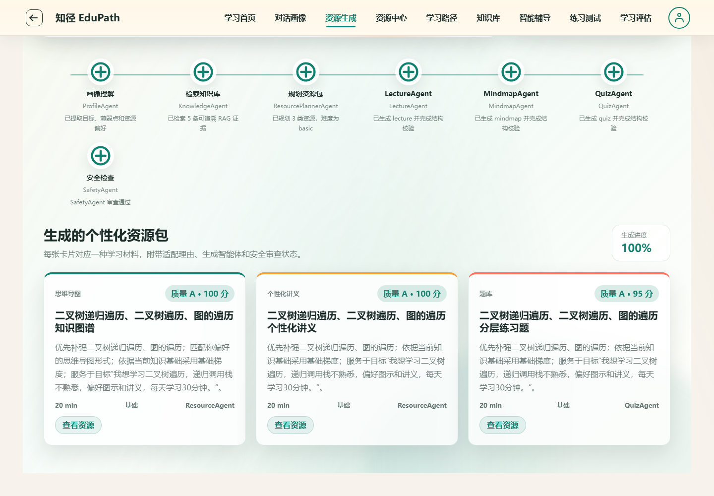

# 知径 EduPath

面向《数据结构与算法》《计算机组成原理》的学习 Web 应用，将学习画像、课程证据检索、资源生成、路径规划和测验反馈连接起来。学生可从具体薄弱点开始学习，查看生成内容的依据，再用练习结果调整下一步；教师端提供班级洞察、教学任务和课程资料管理。

这是软件杯 A3 团队项目的个人公开版本，由团队快照整理后持续维护。Richard-Lee0419 主要负责前端/UI与 AI 模块，并参与后端；部署主要由队友完成。代码基础、个人扩展和代表性提交见 [贡献说明](CONTRIBUTIONS.md)。

**快速入口：** [核心流程视频](docs/evidence/core-learning-flow.webm) · [演示说明](docs/demo-guide.md) · [验证记录](docs/validation-report.md) · [设计取舍](docs/engineering-decisions.md) · [原在线实例](https://8.136.194.87/)

> 视频来自本仓库本地代码，使用合成账号和确定性开发模式，实际执行网页操作与跨服务请求。原在线实例可能与仓库版本不同。小规模真实模型验证中，画像通过，讲义因本次较低输出上限导致 JSON 截断，详见验证记录。项目没有已验证的学习成绩提升或正式用户研究结论。



## 核心流程与当前范围

```text
学习目标与自述 → 版本化画像 → 课程证据 → 资源与学习路径
                                          ↓
下一步调整 ← 画像/路径更新 ← 作答与评估 ← 学习和练习
```

| 场景 | 当前实现 |
| --- | --- |
| 学习画像 | 根据输入提取目标、薄弱点、偏好与时间预算，保存画像版本与更新依据。 |
| 资源学习 | 生成个性化讲义、思维导图、题库、代码实验、流程图、拓展阅读，展示结构化内容与课程证据。 |
| 路径与辅导 | 规划学习顺序，基于检索内容辅导；练习反馈可触发路径调整。 |
| 测验评估 | 保存题目与作答，形成评估，并关联画像与路径变化。 |
| 教师支持 | 班级洞察、教学任务、知识库上传与维护。 |
| 任务进度 | 任务 ID、状态查询、SSE、取消、重新执行及刷新后重新连接已有任务。 |

DFS 的交互图解可展示图结构、访问顺序与递归栈。代码实验是内容和练习引导，当前没有隔离的在线代码执行沙箱。旧 `animation_script` 类型保留历史兼容，不在六类可选资源中。

AI 模块按规划、检索、生成、辅导、评估和安全审核分工，通过 Pydantic 结构传递结果。各角色由编排代码调用，不代表多个自主系统独立讨论。检索实际入口是课程/知识点过滤与向量适配器；BM25 和自适应 MMR 的独立代码尚未接入该入口，详见 [当前检索链路](docs/learner-adaptive-rag.md)。

## 架构与代码入口

```text
Vue 3 / TypeScript
       │ /api/*
       ▼
Spring Boot 业务服务 ── MySQL（本地演示可用 H2）
       │ 内部 AI 请求、任务状态
       ▼
FastAPI / Pydantic ── 课程语料、local 或 Chroma 向量适配器
       └───────────── 可配置的模型接口
```

前端统一调用 Java API。Java 保存用户、课程、资源、作答和任务快照；Python 实现 AI 流水线、检索和输出校验。任务执行使用进程内线程池，重启时不会从生成步骤断点继续。Redis 未接入业务缓存或任务执行；生产模板中保留的 Redis 配置不代表缓存能力。边界及成本见 [系统架构](docs/architecture.md)。

| 路径 | 内容 |
| --- | --- |
| `frontend/` | Vue 页面、资源渲染、任务交互和 TypeScript 类型 |
| `backend-api/` | Spring Boot API、Flyway 迁移、业务测试 |
| `ai-agent-service/` | FastAPI、Agent、检索、生成流水线、测试和公开语料 |
| `api-contract.md` | 前端 API 与内部 AI 接口约定 |
| `scripts/`、`deploy/` | 启动、验证、部署辅助文件 |
| `docs/` | 当前说明及历史阶段报告；历史报告不等于当前版本验证 |

## 本地运行

### Docker Compose

需要 Docker Engine 与 Compose 插件。默认开发组合使用 `.env.example`，端口仅绑定本机；需允许下载镜像和安装依赖，首次启动不保证瞬间就绪。

```bash
git clone https://github.com/Richard-Lee0419/-EduPath.git
cd ./-EduPath
docker compose up --build
```

| 地址 | 用途 |
| --- | --- |
| http://localhost:5173 | Web 应用，登录 `demo / 123456` |
| http://localhost:8080/actuator/health | 业务服务健康检查 |
| http://localhost:8000/health | AI 服务健康检查 |
| http://localhost:8000/runtime | AI 运行模式，检查是否配置真实模型 |

开发口令只用于演示；教师账号为 `teacher / 123456`。线上实例的账号可用性以实际响应为准。停止本地服务使用 `docker compose down`；不加 `-v` 时保留数据库卷。

### 不使用 Docker

需要 Node.js 24、JDK 17、Maven 3.9+、Python 3.11+。在三个终端中分别执行：

```bash
# 终端 1：确定性 AI 开发模式，无需模型密钥
cd ai-agent-service
python -m venv .venv
# 激活虚拟环境：Windows .venv\Scripts\Activate.ps1；macOS/Linux source .venv/bin/activate
python -m pip install -e ".[dev]"
python -m uvicorn app.main:app --host 127.0.0.1 --port 8000

# 终端 2：H2 内存数据库；重启会重建演示数据
cd backend-api
mvn spring-boot:run -Dspring-boot.run.profiles=test

# 终端 3
cd frontend
npm ci
npm run dev -- --host 127.0.0.1
```

直接运行前请确认当前 shell 没有残留生产环境变量。确定性模式需清空 `LLM_PROVIDER`、`LLM_BASE_URL`、`LLM_MODEL`、`LLM_API_KEY`，并使用 `EDUPATH_ENV=dev`、`VECTOR_STORE_PROVIDER=local`、`EMBEDDING_PROVIDER=local`。`.env.example` 并不会被手工启动的 Python 自动读取；Windows 运行脚本可显式传入未跟踪的环境文件。

确定性模式验证业务接口与状态流转，不证明真实模型生成质量。配置模型时可参考 [模型变量示例](ai-agent-service/.env.real-model.example)，并通过 `generation_mode`、`model_runtime` 检查结果来源。远程模型错误可能导致任务失败；路径生成/重规划允许规则路径回退，辅导允许证据摘录回退，均明确标记，不能将其称为真实模型结果。

## 验证与限制

```bash
# frontend/：Node 24 用于现有直接导入 .ts 的测试脚本
npm ci
npm test
npm run type-check
npm run build

# backend-api/
mvn test

# ai-agent-service/，先安装 .[dev]
python -m pytest
```

前端资源解析与事件测试验证结果断言；`test:static-contract` 检查源码约定，旧 `test:real-api` 仅是兼容别名，**不发起 HTTP 请求**。Java 测试使用 H2 和模拟 AI，Python 测试包含确定性流程与模拟模型响应，不能替代真实模型或浏览器验证。跨服务流程、环境与本次结果见 [验证记录](docs/validation-report.md)。本项目尚未配置 ESLint，不能把类型检查称为 lint 通过。

[CI 配置](.github/workflows/ci.yml) 执行前端测试/构建、Java/Python 测试、真实 HTTP 与 Chromium 学习闭环、知识库生命周期，并在独立任务中启动开发 Compose 验证 MySQL/Chroma。[修复后的远程检查](https://github.com/Richard-Lee0419/-EduPath/actions/runs/38068948500) 三组全部通过，包括真实 Chroma 的干扰片段回归；此前的检索失败、提交及结果范围见 [验证记录](docs/validation-report.md)。已启动隔离本地服务时，可执行 `python scripts/smoke_learning_flow.py --output output/validation/learning-flow.json`，知识库检查使用 `python scripts/smoke_knowledge_lifecycle.py --confirm-isolated-local`。这些命令创建合成账号或资料，只允许本地 HTTP 地址，勿连接生产数据库。

浏览器验证与重新录制见 [演示说明](docs/demo-guide.md)，执行 `npm run test:e2e` 或 `npm run test:e2e:record`。本地已通过两项无接口 mock 的浏览器测试；视频覆盖学生流程，教师拒绝上传由另一项测试验证。

本次收尾在 [草稿 PR #1](https://github.com/Richard-Lee0419/-EduPath/pull/1) 中；未合并或部署。README 的成果对应此版本，原在线实例不自动代表它。

已知边界：

- 尚未完成正式学习效果实验；画像响应、路径变化与测试通过不等于教学效果已成立。
- 本地哈希 embedding 便于重复验证，不代表语义检索模型质量；部署采用真实 embedding 时需另行评测。
- 取消是尽力中止任务并阻止结果继续发布，不能保证远程模型请求停止计费；重试从头创建新任务。
- AI 内部任务状态存在内存中，Java 保存任务快照；进程重启会将陈旧运行任务标记失败，不支持断点续跑。
- 新课程需要合法语料、知识点映射、检索评测和人工内容复核；当前没有证明跨课程泛化能力。

## 数据与部署

公开语料及其来源、许可证记录见 [开放知识库说明](docs/open-source-knowledge-base.md) 和 [seed corpus](ai-agent-service/data/seed_corpus/README.md)。公开版本不附教师私有课件、生产数据或密钥；缺失原始资料的历史评测不能作为当前可复现结果。

生产部署参考 [.env.production.example](.env.production.example) 和 [部署说明](docs/production-deployment.md)。生产需单独配置数据库、JWT、对象存储、真实模型及 embedding，并关闭或重新设计共享演示账号。对共享公开演示不要上传真实个人信息或未经授权的课程资料。

## License

代码采用 [Apache License 2.0](LICENSE)。第三方课程资料与依赖适用各自许可证，请按来源清单核对授权范围。
