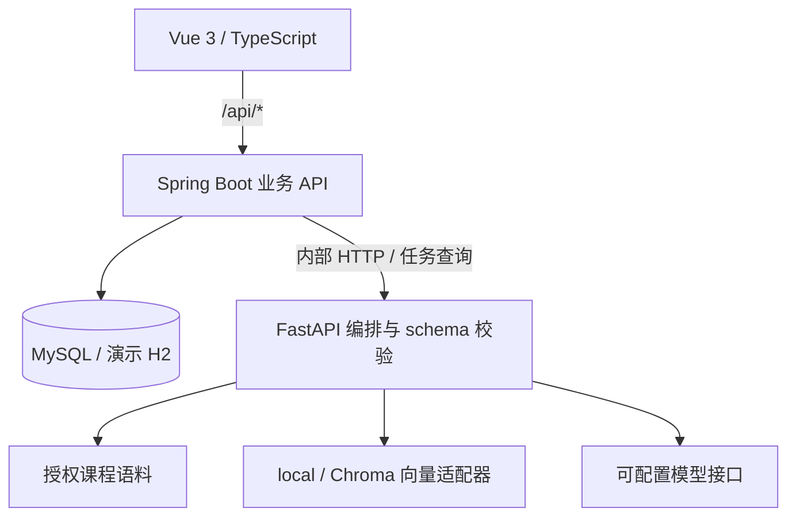

# 当前系统架构

本文描述公开版本的服务边界。替代方案和维护成本见 [设计取舍](engineering-decisions.md)，接口字段以 [API 契约](../api-contract.md) 为准。

## 职责与代码入口

| 层次 | 当前职责 | 入口 |
| --- | --- | --- |
| 前端 | 登录、学习与教师页面、资源渲染、任务重连与进度 | `frontend/src/App.vue`、`src/api/`、`src/pages/` |
| Java | 身份与访问权限、业务数据、任务快照、AI 转发 | `backend-api/src/main/java/com/edupath/`、`src/main/resources/db/migration/` |
| Python | 画像、检索、资源、辅导、路径与评估流水线 | `ai-agent-service/app/agents/orchestrator_agent.py`、`app/services/`、`app/schemas/` |
| 数据 | 业务关系数据、课程分块及出处 | MySQL/Flyway；`app/rag/retriever.py` 与向量适配器 |

浏览器统一调用 Java；Python 接口属于内部服务。Agent 是职责模块与流水线节点，结构化输出用于 Java 持久化及前端渲染，未实现自由对话式自治代理协商。Redis 没有业务调用方，不用于任务队列或缓存。

## 资源生成的状态流转

1. 前端提交主题、课程、难度和资源类型，Java 建立包含操作者与请求的任务记录，返回 `task_id`。
2. Java 的进程内执行器向 Python 发起请求。资源流水线检索课程证据、规划资源、生成内容、校验结构并审核。
3. Java 将输出保存为业务资源并更新任务快照。前端通过 SSE 接收事件，连接不可用时查询状态。
4. 失败进入 `failed`，取消进入 `cancelled`；错误与审核信息用于呈现失败原因。审核失败不能成为正常已发布资源。

源码：`AgentTaskService`、`AgentTaskController`、`AiAgentClient`、`ResourceService`，以及 `resource_generation_pipeline.py`、`task_manager.py`。

## 持久化、重试与“恢复”的边界

Java 保存任务记录、步骤、请求和结果快照；实际执行依赖内存中的 `Future` 与线程池。Python 内部任务及事件保存在内存字典，不能在重启后继续执行。浏览器保存任务 ID，可在刷新后重新连接已有任务，这只是 UI 重连。

Java 启动调用 `markStaleRunningTasksFailed()`，把遗留运行任务标成失败；手动重试按原请求创建新任务，并重新执行流程。当前没有分布式队列、执行步骤检查点或自动断点续跑。

取消尝试中断 Java `Future` 并向相关 AI 任务传递取消。执行中的远程调用不保证立即停止；状态控制必须防止晚到结果覆盖取消状态。现有回归能验证覆盖的本地路径，无法保证所有第三方模型的取消语义。

## 模型与开发模式

`Settings` 和 `LLMGateway` 决定是否配置真实模型。未配置时，开发流程使用规则、模板、检索证据和确定性 embedding。输出携带 `generation_mode`、`model_runtime`，用于区分模式和模型调用记录。

配置模型后，Pydantic 校验、允许的证据 ID、有限重试、内容审核共同约束输出。它们减少接口与内容风险，不构成对教学正确性或无幻觉的保证。辅导可在模型输出不可靠时退回证据摘录，并保留回退标记。

## 验证范围

Java 的 H2/模拟 AI 测试、Python 的确定性/模拟模型测试和本地跨服务验证分别检查不同边界。它们不代替浏览器操作、Chroma/真实 embedding 质量评测或学习效果研究。具体命令、结果及未验证项见 [验证记录](validation-report.md)。
