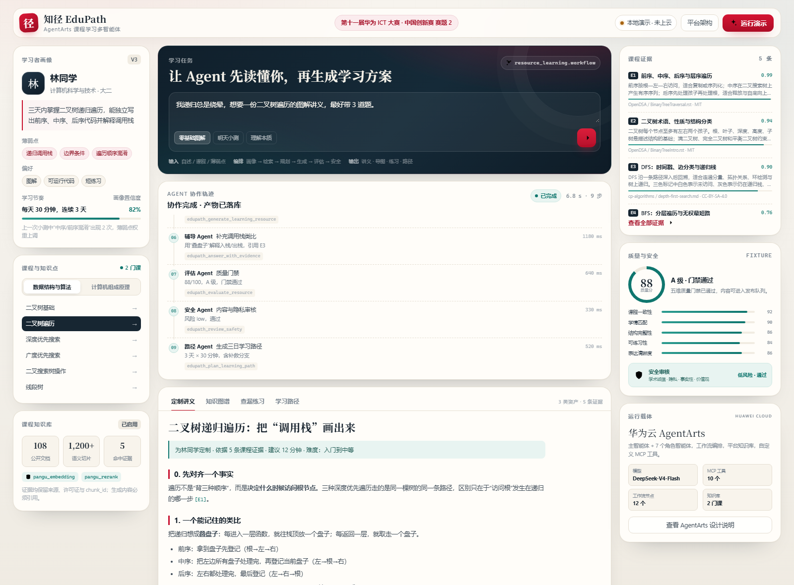

# 知径 EduPath · 华为 ICT 大赛版（AgentArts）

> 第十一届华为 ICT 大赛 · 中国创新赛 · **赛题 2：基于华为云 AgentArts 智能体开发平台的 Agent 设计和应用**
> 作品名：**知径 EduPath——基于华为云 AgentArts 的课程学习多智能体**
> 独立子目录 / 独立分支：`huawei-ict-2026`。**不修改原项目 `main` 的任何代码。**



---

## 这是什么

把 EduPath 的“学习画像—课程证据—资源生成—测验评估—路径调整”闭环，迁移到华为云 AgentArts：

- **8 个角色**：主控、画像、检索、教学设计、生成、辅导、评估、安全。
- **12 节点工作流**：并行检索/生成、质量门禁、安全门禁、发布、路径规划、测验重规划。
- **10 个 MCP 工具**：画像、检索、资源规划、资源生成、路径、辅导、出题、测验分析、安全审核、课程大纲。
- **平台知识库**：2 门课、108 篇公开语料，约 1,200+ 切片，保留来源/许可证。
- **可视化 Demo**：零构建 HTML/CSS/JS，离线可跑；支持 SSE、证据侧栏、Agent 轨迹、练习交互。
- **可提交材料**：作品信息收集表、12 页 PPT、5 张截图、3.5 分钟视频脚本、分享帖草稿。

> **重要边界**：本目录默认运行在 `fixture`（离线彩排）模式，页面会明确显示“本地演示 · 未上云”。正式提交前，必须在 AgentArts 控制台完成知识库/工作流/MCP/发布，并把 `AGENTARTS_ENDPOINT` 指过去。不要把彩排截图说成平台运行。

---

## 30 秒跑起来

```bash
cd huawei-ict
python -m bridge.gateway --port 8765
```

打开 <http://127.0.0.1:8765/>，点“运行演示”。

- 只需 **Python 3.11+**，**无需 pip install**。
- 默认不调用任何云服务；运行约 6.8 秒（按步骤回放）。
- 截图模式：`http://127.0.0.1:8765/?demo=done&full=1&tab=lecture`

### 自检

```bash
python scripts/selfcheck.py
python -m unittest discover -s tests -v
```

预期：16/16 自检通过，14 项单元测试通过。

---

## 目录

```text
huawei-ict/
├── bridge/                  MCP 服务 + 本地编排 + 网关 + AgentArts 客户端
│   ├── mcp_server.py        MCP 2024-11-05：initialize/tools/list/tools/call
│   ├── tools.py             10 个工具 + 可选转发原项目 AI 服务
│   ├── orchestrator.py      本地 9 步流水线（与 AgentArts 工作流一一对应）
│   ├── gateway.py           零依赖 HTTP/SSE + 静态 Demo
│   ├── agentarts_client.py  发布端点适配（generic/openai）
│   ├── demo_data.py         课程证据约束的离线样例
│   └── __init__.py
├── web/                     比赛专用可视化 Demo
├── agentarts/               提示词、工作流声明、知识库配置、MCP 清单、评测集
├── docs/                    赛题解读、差距评估、设计、知识库、MCP、部署、脚本、答辩
├── submission/              信息表、PPT、提交清单
├── evidence/                截图、自检报告
├── scripts/                 selfcheck / 运行脚本
└── tests/                   14 项单元测试
```

---

## 三种运行模式

| 模式 | 环境变量 | 用途 | 页面标识 |
| --- | --- | --- | --- |
| 离线彩排 | `EDUPATH_BRIDGE_MODE=fixture`（默认） | 无账号/无网络也能演示 | 本地演示 · 未上云 |
| 真 RAG | `EDUPATH_BRIDGE_MODE=edupath_ai` + `EDUPATH_AI_BASE_URL` | 复用原项目 AI 服务 | EduPath AI 服务 |
| AgentArts | `EDUPATH_BRIDGE_MODE=agentarts` + `AGENTARTS_ENDPOINT` | 正式提交/录屏 | AgentArts 已发布智能体 |

详见 [部署与联调](docs/05-部署与联调指南.md)。

---

## 先读哪几篇

| 你想知道 | 读这篇 |
| --- | --- |
| 比赛到底要什么、交什么 | [00-赛题解读与提交清单](docs/00-赛题解读与提交清单.md) |
| 原项目差多少、改动大不大 | [01-现状差距与改造评估](docs/01-现状差距与改造评估.md) |
| AgentArts 里怎么搭 | [02-AgentArts智能体设计方案](docs/02-AgentArts智能体设计方案.md) |
| 知识库/语料怎么接 | [03-知识库与语料构建](docs/03-知识库与语料构建.md) |
| MCP 工具怎么注册 | [04-MCP工具服务说明](docs/04-MCP工具服务说明.md) |
| 怎么跑/怎么上云 | [05-部署与联调指南](docs/05-部署与联调指南.md) |
| 视频怎么录 | [06-Demo演示脚本与截图清单](docs/06-Demo演示脚本与截图清单.md) |
| 怎么讲/怎么答辩 | [08-评审得分策略与答辩要点](docs/08-评审得分策略与答辩要点.md) |

---

## 与原项目的关系

| 项 | 说明 |
| --- | --- |
| 原项目 | <https://github.com/Richard-Lee0419/-EduPath>（`main`） |
| 本目录 | 新增子目录，**0 行修改原项目代码** |
| 复用 | 课程语料、RAG、生成、评估、Safety、设计语言 |
| 新增 | AgentArts 平台层、MCP 协议层、比赛 Demo、比赛材料 |
| 分支 | `huawei-ict-2026`（不影响 `main`） |

---

## 当前状态（如实）

| 项 | 状态 |
| --- | --- |
| 本地 Demo + MCP + 9 步流水线 | ✅ 已跑通（16/16 自检，14 单测） |
| 作品信息收集表 | ✅ 已按模板填写（个人信息待补） |
| PPT | ✅ 12 页初稿 |
| 演示截图 | ✅ 5 张（fixture 模式，页面有标识） |
| AgentArts 真实端点 | ⬜ 待账号/知识库/工作流配置 |
| 3.5 分钟视频 | ⬜ 待录制 |
| 平台评测 24 条 | ⬜ 待跑 |
| 分享帖 | ✅ 草稿，待发布 |

---

## 许可证与引用

- 代码：沿用原项目许可证。
- 课程语料：cp-algorithms（CC BY-SA 4.0）、OpenDSA（MIT）、RISC-V ISA Manual（CC BY 4.0）、lowRISC Ibex（Apache 2.0）。使用时保留署名与许可证。
- 本文档中的“88 分/9 步/5 条证据”为演示链路数据；“82/56/29/2”为原项目公开验证记录；不构成学习效果结论。
