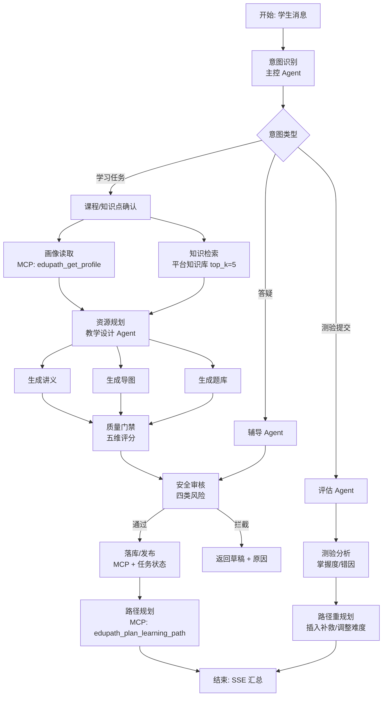

# 02 · AgentArts 智能体设计方案

> 作品名：**知径 EduPath——基于华为云 AgentArts 的课程学习多智能体**
> 一句话：让每一个薄弱点都有**证据**、有**路径**、有**反馈**。
> 说明：AgentArts 控制台的具体页签/字段会随版本变化，本文用“能力名”描述；操作步骤以 `docs/05` 与控制台实际界面为准。

---

## 1. 场景定义

### 1.1 用户与任务

| 角色 | 典型任务 | 当前痛点 | 我们的回应 |
| --- | --- | --- | --- |
| 学生（主） | “我递归绕晕，明天小测，帮我补二叉树遍历” | 通用 AI 给泛化内容；不知道先学什么；练完没有反馈 | 画像 → 证据 → 定制资源 → 练习 → 路径调整 |
| 教师（次） | “给这个班准备一份分层讲义和练习” | 重复备课；难以按薄弱点分层 | 课程包 + 班级画像 + 批量生成（后续） |
| 课程团队 | “换一门课还能用吗？” | 每门课重做一套系统 | 语料/知识点/评测集可替换，工作流复用 |

### 1.2 为什么是现在

- 大模型让“生成”变便宜，但**课程可信度**和**学情连续性**没有解决。
- Agent 平台让“多角色协作 + 工具调用 + 知识接入”工程化，第一次可以把闭环做成产品而不是脚本。
- 华为云 MaaS + AgentArts 提供了模型、知识库、运行时、评测的一体化底座，适合高校场景低成本落地。

### 1.3 场景边界（答辩要说）

- 不替代教师，不自动判卷给最终成绩；分数由业务系统确定性计算，AI 只做解释与建议。
- 不做通用搜题/代写；安全门禁会拦截“直接给考试答案”的请求。
- 目前覆盖 2 门课，不宣称“全学科通用”；复制路径已给出。

---

## 2. 设计原则

1. **证据先于生成**：没有检索到课程证据，不生成确定性结论；弱证据要显式说“资料未覆盖”。
2. **画像可修正**：画像不是一次性标签，带版本、置信度、更新理由；测验结果可触发更新。
3. **职责可拆分**：画像、检索、规划、生成、辅导、评估、安全各自独立，失败可单独重试。
4. **过程可解释**：前端展示 Agent 协作轨迹、工具名、耗时、证据 id；不是黑盒吐字。
5. **发布有门禁**：质量门禁 + 安全审核双通过才落库/发布；不通过就返回草稿与原因。
6. **平台可替换**：模型、知识库、MCP 端点均通过配置注入，不把某次调用的结果写死。

---

## 3. 智能体编制（8 个角色）

| # | 角色 | 职责 | 输入 | 输出 | 工具 | 模型/温度 |
| --- | --- | --- | --- | --- | --- | --- |
| 0 | **知径学伴**（主控） | 意图识别、路由、汇总、失败兜底 | 学生消息、课程、会话 | 工作流选择、最终答复 | `intent.classify` | DeepSeek-V4-Flash / 0.2 |
| 1 | **画像师** | 抽取/更新目标、薄弱点、偏好、节奏 | 自述、历史画像、测验结果 | `ProfileIncrement` JSON | `edupath_get_profile` | DeepSeek-V4-Flash / 0.1 |
| 2 | **检索员** | 课程证据检索、课程隔离、阈值过滤 | 查询、课程 id、top_k | 证据列表（chunk/来源/分数） | 平台知识库 / `edupath_search_knowledge` | pangu_embedding + pangu_rerank |
| 3 | **教学设计** | 选资源类型、定难度、排顺序 | 画像、证据、时间预算 | 资源组合与验收标准 | `edupath_plan_resource_bundle` | DeepSeek-V4-Flash / 0.3 |
| 4 | **内容生成** | 生成讲义/导图/题库/代码实验 | 规划、证据、画像 | 结构化资源（Markdown/JSON） | `edupath_generate_learning_resource` | DeepSeek-V4-Flash / 0.4 |
| 5 | **辅导教练** | 用类比/追问/分步讲解答疑 | 问题、证据、画像 | 带引用的回答、下一步 | `edupath_answer_with_evidence` | DeepSeek-V4-Flash / 0.3 |
| 6 | **评估师** | 质量五维评分、测验分析 | 资源、证据、作答 | 质量分/等级/改进项；掌握度 | `edupath_evaluate_resource`、`edupath_analyze_quiz_result` | DeepSeek-V4-Flash / 0.0 |
| 7 | **安全员** | 学术诚信、隐私、事实性、价值观 | 生成内容、用户输入 | 通过/拦截 + 风险级别 | `edupath_review_safety` | DeepSeek-V4-Flash / 0.0 |

> 平台实现建议：主控用“单智能体”或工作流入口；1–7 用工作流节点/子智能体；不要把 8 个角色做成 8 个独立对外应用，否则演示与权限都难管。

### 3.1 角色提示词

完整提示词见 `agentarts/prompts/`：

- `orchestrator.md`：路由与汇总
- `profile.md`：严格 JSON、缺失字段留空、不编造
- `retriever.md`：只依据证据、弱证据拒答
- `planner.md`：资源组合与时间预算
- `generator.md`：引用格式、结构模板、难度控制
- `tutor.md`：苏格拉底/分步/提示三种模式
- `evaluator.md`：五维评分与门禁
- `safety.md`：四类风险与拦截话术

---

## 4. 工作流架构

### 4.1 主流程（学习任务）



### 4.2 节点清单（12 个执行节点 + 开始/结束/分支）

> 口径：**12 个执行节点**指主链路上真正做事的节点（意图、课程、画像、检索、规划、三路生成、质量、安全、发布、路径），不含开始/结束、条件分支、异常出口与辅导/测验分支。`agentarts/workflow.json` 的完整声明共 25 个节点。

| # | 节点 | 类型 | 关键配置 | 失败处理 |
| --- | --- | --- | --- | --- |
| 1 | 开始 | 开始 | 入参：message/course_id/session_id | — |
| 2 | 意图识别 | LLM | JSON 输出：intent/confidence/entities | 低置信度走澄清话术 |
| 3 | 条件分支 | 条件 | intent in [learn, tutor, quiz] | 默认 learn |
| 4 | 课程确认 | 代码/变量 | 校验 course_id、知识点 | 回退到课程大纲 |
| 5 | 画像读取 | MCP | `edupath_get_profile` | 失败用匿名画像，标注 |
| 6 | 知识检索 | 知识库 | top_k=5，阈值 0.35，课程过滤 | 0 命中则拒答/换关键词 |
| 7 | 资源规划 | LLM | 输出 resource_types/difficulty | 回退默认组合 |
| 8 | 并行生成 | 并行 | 讲义/导图/题库三路 | 单路失败不影响其他 |
| 9 | 质量门禁 | LLM + 代码 | 5 维加权，≥80 且 gate=true | 返回草稿 + 改进项 |
| 10 | 安全审核 | LLM | 4 类风险，high 直接拦截 | 拦截并记录 |
| 11 | 发布/落库 | MCP | 任务状态、资源 id | 重试 1 次 |
| 12 | 路径规划 | MCP | 3 天 × 30 分钟 | 规则路径回退 |
| 13 | 结束 | 结束 | 汇总 artifacts/trace/metrics | — |

> 12 个节点是“主流程”；测验分支可复用同一工作流，用条件分支进入“评估→重规划”。

### 4.3 并行与串行

- **并行**：画像读取与知识检索可并行；三类资源生成可并行。并行是为了缩短时延，不是为了炫技。
- **串行**：质量门禁必须在生成之后；安全审核必须在发布之前；路径规划必须在资源落库之后（需要 resource_id）。
- **幂等**：发布节点用 `task_id + resource_type` 做幂等键，重试不产生重复资源。

---

## 5. 知识接入

### 5.1 两种接入方式

| 方式 | 适用 | 优点 | 限制 |
| --- | --- | --- | --- |
| **平台知识库**（推荐） | 平台内工作流/智能体 | 引用、召回测试、pangu_embedding/rerank 开箱即用 | 不对外提供检索 API；只能平台内用 |
| **第三方知识库接口** | 想复用现有 Chroma | 保留原 RAG | 需要你实现 `GET /knowledge-bases`、`POST /knowledge-bases/retrieve` 给平台调 |
| **MCP 检索工具**（备选） | 高代码 Agent | 灵活 | 引用展示要自己做；平台知识库能力用不上 |

本方案主路径用**平台知识库**，MCP 的 `edupath_search_knowledge` 作为补充/高代码路径。详见 `docs/03`。

### 5.2 检索参数（建议起点）

| 参数 | 值 | 说明 |
| --- | --- | --- |
| 分段 | 自动分段，标题层级 3，约 500 字 | 与现有语义分段对齐 |
| top_k | 5 | Demo 够用；太多会稀释引用 |
| 阈值 | 0.35 | 低于阈值不进入生成；宁可拒答 |
| 课程过滤 | course_id | 防止跨课程串味 |
| 引用 | 开启 | 回答必须带来源 |
| 重排 | pangu_rerank | 提升首条命中率 |

### 5.3 证据契约

生成节点必须输出：

```json
{
  "evidence_chunk_ids": ["E1", "E2"],
  "claims": [
    {"text": "前序是根—左—右", "evidence": ["E1"]}
  ]
}
```

发布前校验：`claims` 中每条有引用；引用 id 在检索结果中存在；不满足则降级为“草稿”。

---

## 6. 模型与资产选择

| 资产 | 选择 | 理由 | 备选 |
| --- | --- | --- | --- |
| 主模型 | DeepSeek-V4-Flash（MaaS 预置） | 中文教学表达好、成本低、响应快 | 盘古大模型 |
| Embedding | pangu_embedding | 平台知识库默认，中文课程语料适配 | 第三方 embedding |
| Rerank | pangu_rerank | 提升弱命中排序 | 无 |
| 知识库 | AgentArts 平台知识库 | 引用/命中测试/权限一体 | 第三方 KB 接口 |
| 工具协议 | MCP（JSON-RPC） | 平台可发现、可复用、跨语言 | OpenAPI 插件 |
| 记忆 | AgentArts 记忆库（可选） | 跨会话记住学习目标 | 业务库画像 |
| 评测 | AgentArts 评测 + 本地评测集 | 平台记录 + 可复现 | 仅本地脚本 |
| 前端 | 零构建 HTML/CSS/JS | 评委机器无需安装 | Vue 子应用 |

### 6.1 模型调用策略

- 温度：画像/评估/安全 0.0–0.1；规划 0.3；生成 0.4；辅导 0.3。
- 输出：强制 JSON（Pydantic/JSON Schema 校验）；失败重试 1 次，仍失败则降级模板。
- 超时：单节点 60s；工作流总超时 180s；超时返回可解释错误，不静默兜底。
- 成本：Demo 单次约 6–10 次模型调用；用 Token Plan 控制；录制时避免重复跑。

---

## 7. 交互设计

### 7.1 页面结构

```text
┌──────────────────────────────────────────────────────────────┐
│ 品牌 / 赛题徽标 / 运行模式（AgentArts / 本地） / 运行演示      │
├──────────────┬───────────────────────────────┬───────────────┤
│ 学习者画像    │ 学习任务输入                   │ 课程证据       │
│ 课程/知识点   │ Agent 协作轨迹（9 步）          │ 质量/安全      │
│ 知识库状态    │ 产物工作台（讲义/导图/题/路径） │ 运行载体       │
└──────────────┴───────────────────────────────┴───────────────┘
```

### 7.2 三个交互创新点

1. **任务卡而不是聊天框**：输入一次，产出四类资产；聊天只用于追问。
2. **协作轨迹可视化**：每个 Agent 的名称、工具、耗时、决策理由可见；评委能“看见”编排。
3. **证据侧栏**：每条结论可回到 chunk/来源/许可证；不是“模型说的”。

### 7.3 演示路径（3.5 分钟）

见 `docs/06`。核心：画像 → 证据 → 生成 → 练习 → 评估 → 路径变化。

---

## 8. 创新点（对应 60%）

| 创新 | 为什么不是“包装” | 证据 |
| --- | --- | --- |
| **课程证据约束生成** | 不是 RAG 问答，而是资源级“claims→evidence”契约；弱证据拒答 | 5/5 段落引用、质量门禁 |
| **画像—路径闭环** | 测验结果真的改画像版本与路径任务，不是一次性推荐 | 画像 v3、路径 3 天调整策略 |
| **质量/安全双门禁** | 生成不等于发布；不通过返回草稿与原因 | 五维评分 88、4 类安全检查 |
| **Agent 协作可解释** | 轨迹含工具、耗时、决策，不是黑盒 | Demo 轨迹侧栏 |
| **低侵入 MCP 复用** | 不重写业务系统，把既有能力注册为工具 | 10 个工具、原项目 0 改动 |

### 8.1 与现有方案的差异

| 对比对象 | 它们通常怎么做 | 我们不同在哪 |
| --- | --- | --- |
| 通用 AI 学习助手 | 通用知识问答、一次性推荐 | 课程证据 + 版本化画像 + 测验回流 |
| 题库/刷题 App | 题海、答案解析 | 先画像后出题；错题改路径；生成讲义/导图 |
| MOOC/课程平台 | 统一进度、视频 | 个体薄弱点驱动；教师可批量生成 |
| 单 Agent RAG | 检索→回答 | 多角色分工、质量/安全门禁、任务状态 |

---

## 9. 效果评估

### 9.1 指标定义

| 指标 | 定义 | 数据来源 | 目标（不是承诺） |
| --- | --- | --- | --- |
| 任务成功率 | 端到端完成且产物通过门禁 / 总任务 | 平台运行记录 | ≥ 95% |
| 证据覆盖率 | 有引用的段落 / 总段落 | 质量门禁 | 100% |
| 引用可追溯率 | 引用 id 能在检索结果中找到 / 总引用 | 校验脚本 | 100% |
| 安全拦截率 | 风险样本被拦截 / 风险样本 | 评测集 | 100%（高危） |
| P95 时延 | 端到端耗时 95 分位 | 平台日志 | < 30s（真实模型） |
| 教师备课时间 | 一份分层讲义+练习的准备时间 | 小范围试用 | 45 → 15 分钟（目标） |
| 学生完成率 | 完成任务的学生 / 打开任务的学生 | 产品埋点 | 待试点 |

### 9.2 已有工程验证（可直接引用）

- AI 服务 82 项测试、Java 56 项、前端 29 项断言、2 项 Chromium E2E 通过。
- 真实 HTTP 学习闭环：5 个任务成功，三类资源落库，画像/路径 1→2。
- 知识库生命周期：上传→检索→重建→拒绝→删除。
- CI 三组通过（前端、后端+AI、Docker 集成）。

> 这些证明“工程流程”，不证明“学习成绩提升”。比赛材料要分开写。

### 9.3 平台评测集

`agentarts/evaluation_set.jsonl` 共 24 条，覆盖：

- 正常学习任务（8）
- 弱证据/无证据（4）
- 学术诚信风险（4）
- 边界条件/空输入（3）
- 跨课程隔离（3）
- 追问/多轮（2）

每条含 `input`、`expected_intent`、`must_include`、`must_not_include`、`risk`。平台评测时按“意图正确 / 关键点覆盖 / 引用存在 / 风险拦截”四项打分。

---

## 10. 失败与降级

| 失败点 | 表现 | 处理 |
| --- | --- | --- |
| 知识库 0 命中 | 无证据 | 拒答/换关键词/提示“资料未覆盖”，不编造 |
| 模型超时 | 节点失败 | 重试 1 次；仍失败返回草稿与错误码 |
| 质量门禁不通过 | 分数 < 80 | 不发布，返回改进项；可人工复核 |
| 安全拦截 | high risk | 直接拒绝，记录；不进入发布 |
| MCP 工具不可用 | 连接失败 | 工作流报错；本地 Demo 回退 fixture 并标注 |
| AgentArts 未配置 | 端点为空 | 本地链路彩排；UI 显示“未上云” |

---

## 11. 平台落地清单（按此顺序做）

1. 创建知识库 `edupath-course-kb`，上传 2 门课语料，跑命中测试。
2. 创建单智能体 `edupath-kb-qa`，挂知识库，验证引用与拒答。
3. 创建 MCP 服务（本仓库 `bridge`），在平台注册，工具列表 10 个。
4. 创建工作流 `edupath-learning-flow`，按 12 节点配置。
5. 试运行 3 条正常 + 3 条风险样本，记录截图。
6. 提交版本 `vYYYYMMDDHHmm`，写版本说明。
7. 发布 API / Web 应用，把端点写入 `AGENTARTS_ENDPOINT`。
8. 跑 24 条评测集，导出结果。
9. 录制 3.5 分钟视频（平台配置 + Demo 运行）。
10. 更新信息表/PPT/分享帖。

---

## 12. 答辩边界（不要说过头）

- 不说“平台强制多智能体”；说“场景需要角色拆分”。
- 不说“平台知识库可被任意高代码 Agent 调用”；说“平台内智能体使用平台知识库，高代码路径用 MCP 检索”。
- 不说“提升学习成绩”；说“工程闭环已验证，学习效果待试点”。
- 不说“全学科通用”；说“2 门课已验证，复制方法是换语料/元数据/评测集”。
- 不说“完全自动批改”；说“分数由业务系统确定性计算，AI 做解释与建议”。
